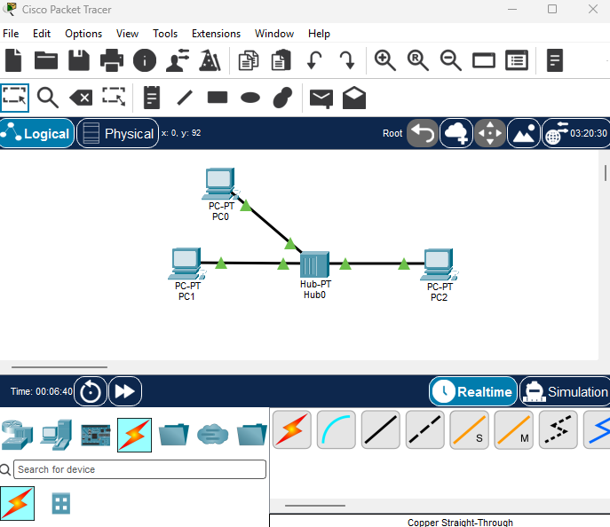
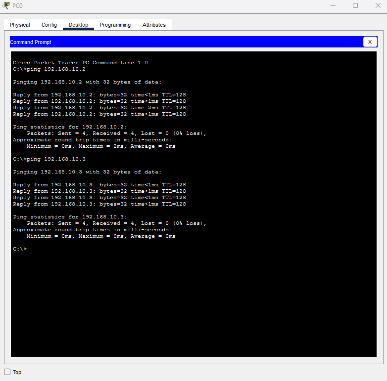
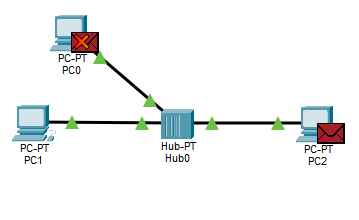
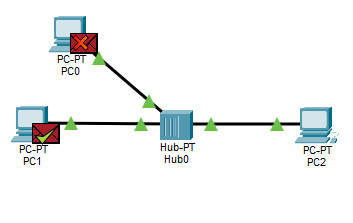

# Bus-Topologie

## Hinweis zur Ersatzsimulation

Packet Tracer kann das klassische Koaxial-Bus-Kabel nicht originalgetreu nachbilden.
Diese Simulation nutzt daher einen **Hub**, der das Busverhalten logisch nachbildet:
Jedes Datenpaket wird an alle Anschlüsse weitergeleitet.

Physisch handelt es sich um eine **Sternform**. Die Bus-Eigenschaft ist logisch.

## Geräte

- 3 × PC-PT (PC0, PC1, PC2)
- 1 × Hub-PT (Hub0)
- 3 × Kabel: Copper Straight-Through

## IP-Adressplan

| Gerät | IP-Adresse   | Subnetzmaske  |
|-------|--------------|---------------|
| PC0   | 192.168.10.1 | 255.255.255.0 |
| PC1   | 192.168.10.2 | 255.255.255.0 |
| PC2   | 192.168.10.3 | 255.255.255.0 |

## Tests (Ping)

| Test          | Gesendet | Empfangen | Verlust |
|---------------|----------|-----------|---------|
| PC0 → PC1     | 4        | 4         | 0 %     |
| PC0 → PC2     | 4        | 4         | 0 %     |
| PC1 → PC2     | 4        | 4         | 0 %     |

## Simulation Mode

Eine Nachricht von PC1 an PC2 wird über den Hub weitergeleitet.
PC0 empfängt das Paket ebenfalls und verwirft es, da es nicht das Ziel ist.
PC2 antwortet, und die Antwort läuft wieder über den Hub zurück an PC1.

## Fehleranalyse

### Fehler 1: Doppelte IP-Adresse

[PC1] bekam die Adresse [192.168.10.1], die bereits [PC0] gehörte.

## Meine Lernerkenntnisse

Überrascht hat mich, dass PC0 die Pakete bekommen hat, obwohl sie nicht für PC0 bestimmt waren. Erst im Simulation Mode habe ich gesehen, dass der Hub jedes Paket an alle Anschlüsse weitergibt und PC0 es dann verwirft.
