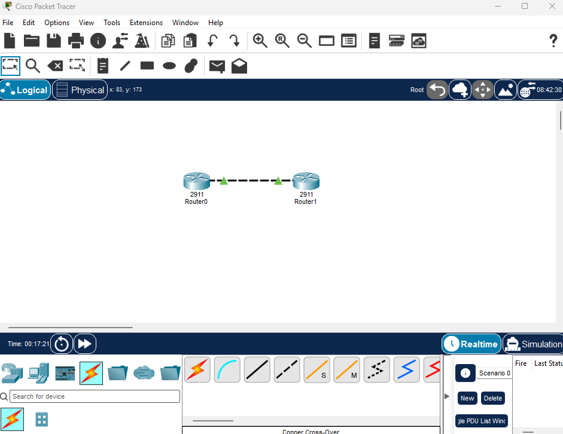
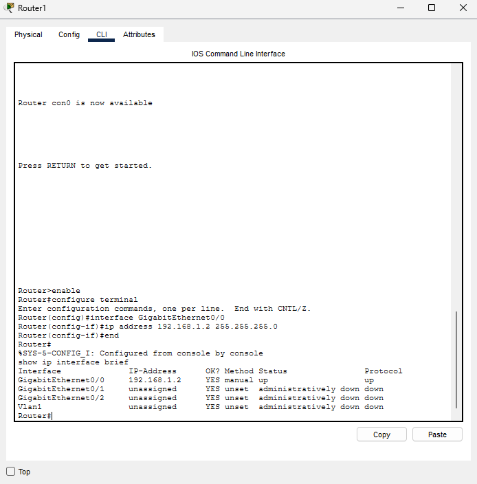
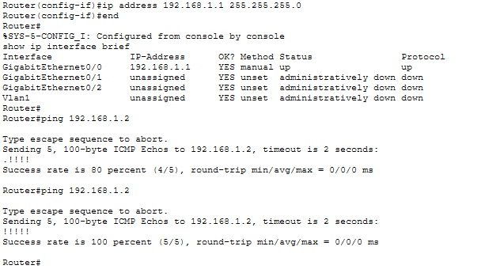

# Punkt-zu-Punkt-Topologie

## Beschreibung
Zwei Router sind direkt über eine Ethernet-Verbindung (Copper Cross-Over) miteinander verbunden.

## Geräte
- Router0 (2911), Schnittstelle GigabitEthernet0/0, IP 192.168.1.1/24
- Router1 (2911), Schnittstelle GigabitEthernet0/0, IP 192.168.1.2/24

## Schritte
1. Zwei 2911-Router platziert und mit Copper Cross-Over verbunden.
2. Schnittstellen mit `no shutdown` aktiviert.
3. IP-Adressen mit `ip address` gesetzt.
4. Mit `ping 192.168.1.2` getestet.

## Testergebnis
- Ping von Router0 zu Router1: Erster Durchlauf 4/5 Antworten (ein Paket ging beim ersten Auflösen der Adresse verloren), zweiter Durchlauf 5/5 (100 Prozent).

## Fehler und Lösungen
- Kabel ließ sich zunächst nicht anschließen: Mit Copper Cross-Over und GigabitEthernet0/0 hat es geklappt.
- Schnittstelle war `administratively down`: Mit `no shutdown` behoben.
- Tippfehler `adress` statt `address`: Befehl korrigiert.

## Lernerkenntnisse
- Schnittstellen sind ab Werk deaktiviert und müssen aktiviert werden.
- Geräte können nur im selben Netz direkt miteinander sprechen.
