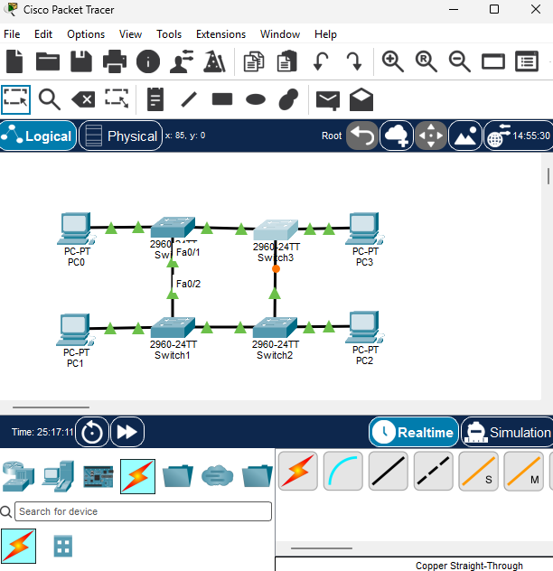
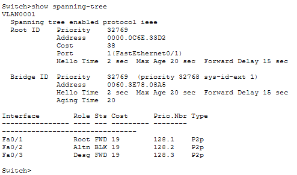

# Ring-Topologie

## Status

In Arbeit: Theorie und Planung abgeschlossen, Aufbau noch offen.

## Theorie

Bei der Ring-Topologie ist jedes Gerät mit genau zwei Nachbarn verbunden. Zusammen bilden sie einen geschlossenen Kreis. Daten werden von Gerät zu Gerät weitergereicht, bis sie beim Empfänger ankommen. Jedes Gerät prüft die Zieladresse und gibt das Paket an den nächsten Nachbarn weiter, wenn es nicht für es bestimmt ist.

- **Vorteile:** Kein zentraler Verteiler nötig, klarer Datenfluss.
- **Nachteile:** Fällt eine Verbindung aus, ist der Weg zwischen den Stationen unterbrochen. Jedes Gerät muss Pakete weiterreichen, dadurch können Verzögerungen entstehen.

## Ersatzsimulation

Ein Ring aus PCs ist in Packet Tracer nicht sauber umsetzbar, weil PCs nur einen Netzwerkanschluss haben und nicht als Weiterleitungspunkt dienen. Deshalb wird der Ring mit vier Switches nachgebildet, die im Kreis verbunden sind.

Physisch ist das ein Ring. Da die Switches eine Schleife bilden, blockiert das Spanning Tree Protocol (STP) einen Port, um eine Endlosschleife zu verhindern. Logisch wirkt das Netz dann wie eine Kette.

- Physisch entsteht ein geschlossener Ring aus Switches.
- Logisch blockiert das Spanning Tree Protocol eine Verbindung, damit keine Schleife entsteht. Das Netz verhält sich dadurch wie eine Kette.
- Bei einem Kabelausfall wird die blockierte Verbindung aktiv, und die Daten laufen über den anderen Weg.
- Bei einem Switch-Ausfall ist nur der dort angeschlossene PC vom Netz getrennt.

## Geräte

- 4 × Switch 2960-24TT (Switch0 bis Switch3)
- 4 × PC-PT (PC0 bis PC3), je einer an einem Switch
- Ring-Verbindungen: Copper Straight-Through (Fa0/1 und Fa0/2 der Switches)
- PC-Anschlüsse: Copper Straight-Through (Fa0/3)

## IP-Adressplan

| Gerät | IP-Adresse   | Subnetzmaske  |
|-------|--------------|---------------|
| PC0   | 192.168.30.1 | 255.255.255.0 |
| PC1   | 192.168.30.2 | 255.255.255.0 |
| PC2   | 192.168.30.3 | 255.255.255.0 |
| PC3   | 192.168.30.4 | 255.255.255.0 |

## Spanning Tree: blockierter Port

Da die Switches einen geschlossenen Ring bilden, würde ohne Schutz eine Schleife entstehen. Das Spanning Tree Protocol (STP) blockiert deshalb einen Port.

Ausgabe von `show spanning-tree` auf [Switch-Name]:

| Interface | Rolle | Status | Bedeutung                         |
|-----------|-------|--------|-----------------------------------|
| Fa0/1     | Root  | FWD    | Weg zur Root-Bridge, aktiv        |
| Fa0/2     | Altn  | BLK    | Alternative, blockiert            |
| Fa0/3     | Desg  | FWD    | Anschluss zum PC, aktiv           |

Beobachtung: Der Port Fa0/2 ist blockiert, der Port Fa0/1 ist der Root-Port. Im Netz ist dadurch kein Pfad doppelt aktiv.

## Tests

_Noch nicht durchgeführt._ Geplant sind Ping-Tests zwischen allen PCs sowie ein Test mit einem unterbrochenen Ring-Kabel.

## Fehleranalyse

_Noch offen._

## Meine Lernerkenntnisse

_Hier deine eigenen Erkenntnisse ergänzen._
