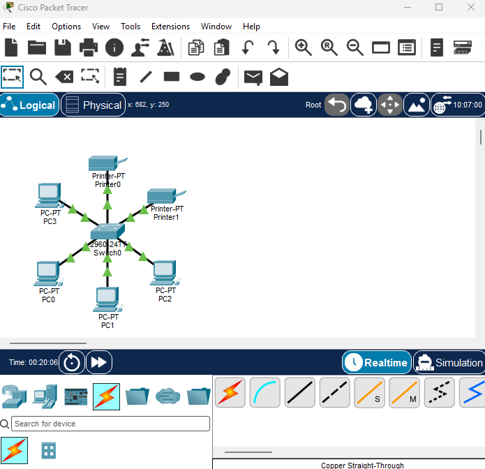
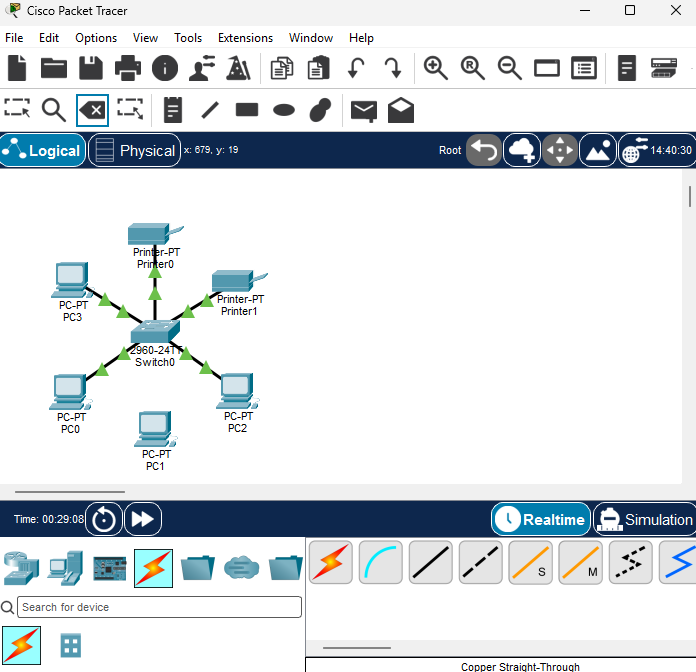
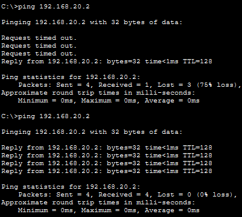
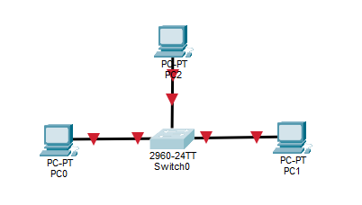
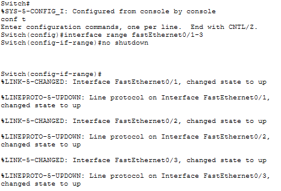

# Stern-Topologie

## Aufbau

Alle Geräte hängen mit einem eigenen Kabel an einem zentralen Switch (2960-24TT).
Anders als beim Hub leitet der Switch Pakete nur an den Port weiter, an dem das Zielgerät hängt.
Diese Topologie wird direkt mit Packet Tracer nachgebildet, es ist also keine Ersatzsimulation nötig.

## Geräte

- 1 × Switch 2960-24TT (Switch0)
- 4 × PC-PT (PC0, PC1, PC2, PC3)
- 2 × Printer-PT (Printer0, Printer1)
- Verbindungen: Copper Straight-Through

## IP-Adressplan

| Gerät     | IP-Adresse     | Subnetzmaske  |
|-----------|----------------|---------------|
| PC0       | 192.168.20.1   | 255.255.255.0 |
| PC1       | 192.168.20.2   | 255.255.255.0 |
| PC2       | 192.168.20.3   | 255.255.255.0 |
| PC3       | 192.168.20.4   | 255.255.255.0 |
| Printer0  | 192.168.20.5   | 255.255.255.0 |
| Printer1  | 192.168.20.6   | 255.255.255.0 |

## Tests

| Test                | Gesendet | Empfangen | Verlust |
|---------------------|----------|-----------|---------|
| PC0 → PC1           | 4        | 4         | 0 %     |
| PC0 → PC2           | 4        | 4         | 0 %     |
| PC0 → PC3           | 4        | 4         | 0 %     |
| PC0 → Printer0      | 4        | 4         | 0 %     |
| PC0 → Printer1      | 4        | 4         | 0 %     |

## Ausfall-Test

Das Kabel zu PC1 wurde getrennt.
Ping von PC0 an PC1 im ersten Lauf: 3 × „Request timed out“, danach 1 Antwort, sobald das Kabel wieder verbunden war.
Ergebnis: 1 von 4 Paketen empfangen (75 % Verlust).
Nach dem Wiederverbinden: 4 von 4 Paketen empfangen (0 % Verlust).

## Switch-Ausfall-Test (CLI)

Ziel: Prüfen, was passiert, wenn der Switch seine Ports deaktiviert.

Vorgehen:
1. CLI von Switch0 öffnen.
2. Befehle eingeben:
   - `enable`
   - `configure terminal`
   - `interface range fastEthernet0/1-24`
   - `shutdown`
   - `end`
3. Die Konsole bestätigt: Alle Ports wurden mit „administratively down“ deaktiviert.
   Die Meldung „Line protocol … changed state to down“ zeigt, dass die Verbindungen unterbrochen sind.

   

Wiederherstellung (teilweise):
- Mit `interface range fastEthernet0/1-3` und `no shutdown` wurden nur die Ports 0/1 bis 0/3 wieder aktiviert.
- Die Ports 0/4 bis 0/24 sind weiterhin deaktiviert.

 

Beobachtung: Der Switch meldet jede Zustandsänderung einzeln an der Konsole. Diese Meldungen sind hilfreich, um einen Ausfall im Netz schnell zu erkennen.

## Fehleranalyse

### Teilweise Wiederherstellung (geplant)

Um zu prüfen, ob sich einzelne Ports gezielt wieder aktivieren lassen, wurden nur die Ports FastEthernet0/1 bis 0/3 mit `no shutdown` reaktiviert. Die Ports FastEthernet0/4 bis 0/24 blieben bewusst deaktiviert.

Beobachtung: Die Konsole bestätigt für 0/1 bis 0/3 den Zustand „up“. Die übrigen Ports bleiben „administratively down“.
